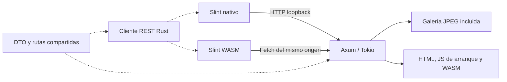

# Arquitectura y contratos de la demo

Este documento conserva el contrato histórico de la demo S01: galería sintética
de solo lectura. La aceptación registrada en [BUILDS.md](../BUILDS.md) corresponde
a ese alcance. El importador v2 del worktree candidato se describe por separado
más abajo y en [RUN.md](RUN.md); todavía no tiene aceptación runtime. No uses los
runs S01 como evidencia de importación.

## Componentes



| Paquete | Responsabilidad |
|---|---|
| `photo-culler-api` | DTO Serde, rutas y límites de la demo. Compila en nativo y `wasm32-unknown-unknown`. |
| `photo-culler-client` | Transporte de lectura, decodificación de respuestas y estado de carga. El cliente actual tiene una interfaz síncrona y de texto; se conserva y la demo incorpora un módulo con respuestas de bytes y soporte asíncrono. |
| `photo-culler-server` | Binario Rust. Monta el router, la galería incluida y la distribución web. Reutiliza el módulo de diagnóstico y la política de origen a través de adaptadores. |
| `photo-culler-slint` | Una ventana `.slint`, controlador Rust común y dos puntos de entrada. El transporte nativo y el de navegador permanecen detrás de `cfg` y features del paquete. |

La composición S01 usa una galería incluida, sin SQLite ni acceso a bibliotecas
del usuario. Esos límites describen únicamente el demo aceptado, no el candidato
de importación.

## Contrato HTTP y fixture

La tabla siguiente documenta únicamente las rutas `/api/v1` del demo S01.

Origen canónico `http://127.0.0.1:<puerto>`. Rutas de la demo:

| Método y ruta | Respuesta satisfactoria | Error esperado |
|---|---|---|
| `GET /api/v1/health` | `200`, JSON `{"status":"ready","resources":null,"request_id":"req-example"}`. | `503` si el servicio no puede atender sus datos. |
| `GET /api/v1/galleries/demo/photos` | `200`, `DemoGalleryPage` con el fixture. | `404` para otra galería. `400` para parámetros ajenos al contrato. |
| `GET /api/v1/photos/demo-001/thumbnail/800` | `200`, `image/jpeg`. El tamaño del JPEG se limita a 800 px en su lado mayor. | `404` para otro identificador o variante. |
| `GET /` y rutas de distribución declaradas | `200`, `text/html`, JavaScript o `application/wasm` según corresponda. | `404` real para un recurso ausente. |

## Importación REST v2 candidata: pendiente de aceptación runtime

El candidato incorpora otro recorrido detrás de un catálogo SQLite persistente:
el servidor registra raíces configuradas mediante `--authorized-root`, la UI
trabaja con IDs opacos de fuente y trabajo, y el API ofrece lista de fuentes,
estimate, start, seguimiento, pausa, reanudación, cancelación y rescan. Sus rutas
principales son `GET /api/v2/galleries/{gallery_id}/sources`,
`POST /api/v2/import-estimates`,
`POST /api/v2/galleries/{gallery_id}/imports`,
`GET /api/v2/import-jobs[?active_only=true]`,
`GET /api/v2/import-jobs/{job_id}` y los subrecursos `pause`, `resume` y
`cancel`. El detalle operativo y los cuerpos confirmados por los DTO están en
[RUN.md](RUN.md).

La frontera de acceso es configuración local del servidor: las raíces deben
existir, ser directorios y no solaparse; el cliente envía `source_id`, nunca una
ruta del sistema. El servidor permanece en loopback. La aceptación S01 citada
arriba no demuestra estos contratos, la reconciliación SQLite, persistencia tras
reinicio ni el comportamiento con bibliotecas grandes. Todo eso sigue pendiente
de verificación runtime sobre un SHA identificado.

El recorrido candidato construye un manifiesto durable por trabajo en lotes
acotados, sin ordenar ni retener todos los nombres en RAM. SQLite proporciona
las páginas de rutas con orden portable `/`; los archivos se verifican y se
hashean después de completar el manifiesto. Si se reanuda un manifiesto parcial,
se vacía y reconstruye; uno completo continúa desde el cursor guardado. La
reconciliación final ahora copia observaciones y archivos existentes a tablas
temporales SQLite mediante páginas de lectura, conserva una sola transacción de
escritura y procesa las acciones en páginas acotadas. `adopt_legacy_files`
recorre filas por ID y guarda candidatos en otra tabla temporal para deduplicar
y comprobar colisiones sin retener todas las filas en Rust; mantiene en memoria
la lista de raíces configuradas. Tampoco están medidos la latencia de la
transacción ni el consumo pico. El modo de almacenamiento temporal tampoco está fijado:
SQLite puede mantener esas tablas en RAM o escribir temporales según su
configuración de compilación/`temp_store`. Falta ejecutar el benchmark de 10.000
entradas y registrar tiempo, RAM pico y espacio temporal contra el SHA exacto.
La estimación previa recorre las entradas sin conservarlas todas, pero mantiene
en memoria una clave por foto lógica para contar grupos distintos; su consumo de
RAM crece con el número de fotos. El recorrido mantiene un solo directorio
abierto a la vez y conserva rutas de directorios pendientes; la memoria de esa
pila puede crecer en árboles anchos. Este cambio aún requiere aceptación en
ejecución con árboles profundos, anchos y modificados durante el recorrido.
Las comprobaciones de enlaces y rutas no son atómicas frente a modificaciones
concurrentes del árbol; esa carrera requiere una solución a nivel de acceso al
sistema de archivos y permanece pendiente.
La reconciliación rechaza una importación si una clave normalizada agruparía
archivos cuyos directorios o nombres difieren en mayúsculas. La regla también
rechaza pares y sidecars con esa diferencia aunque se pretendiera asociarlos.
También rechaza grupos distintos que resuelvan a la misma identidad histórica;
esto puede detener un rescan cuando solo se mueve el RAW de un par RAW/JPEG.
No corrige asociaciones ya guardadas; esos casos requieren una política de
identidad compatible.
Al completar o cancelar un trabajo se eliminan sus observaciones y páginas
temporales en la misma transacción. Si el worker marca un trabajo como fallido,
la API también limpia el staging no reanudable en la transacción que persiste el
estado terminal; el código de error y el log del servidor conservan el motivo.
Si una cancelación ya se ha persistido cuando falla el worker, la transición
terminal da prioridad a `cancelled` y registra el error del worker en el log.
SQLite puede reutilizar páginas liberadas en scans futuros, aunque el archivo de
base de datos no se reduce físicamente sin una operación de compactación.

La UI consulta el historial reciente durante el seguimiento para detectar
importaciones terminadas, incluso si no están seleccionadas; actualmente revisa
como máximo 100 trabajos por consulta. La reconciliación y el coste de estas
consultas siguen pendientes de aceptación en ejecución. Una respuesta tardía
al inicio de una importación puede volver a cargar el diálogo y reiniciar la
selección o estimación que se estuviera editando.

El candidato de miniaturas aplica la orientación EXIF y prueba otras
representaciones disponibles si una no puede decodificarse. La aceptación del
escaneo no implica que exista un decodificador para cada formato: BMP, GIF y
WebP tienen decodificadores habilitados, pendientes de aceptación runtime;
RAW y HEIC/HEIF aún necesitan integración de decodificación.
La verificación de la ruta de una miniatura y su apertura tampoco son atómicas
frente a cambios concurrentes del árbol; la apertura relativa a una raíz con
política de enlaces debe resolverse por plataforma.

```json
{
  "gallery_id": "demo",
  "items": [
    {
      "photo_id": "demo-001",
      "filename": "demo-001.jpg",
      "decision": "undecided",
      "representation": "jpeg",
      "thumbnail_url": "/api/v1/photos/demo-001/thumbnail/800"
    }
  ],
  "next_cursor": null,
  "total": 1
}
```

`next_cursor` se serializa como `null` en esta demo. `total` es el tamaño de `items`. La versión inicial solicita la galería completa y no envía un cursor, filtro ni `limit`. Para los dobles, la galería vacía tiene el mismo ID, `items: []` y `total: 0`. El error JSON es `{"code":"not_found","message":"...","request_id":"req-example"}` y sus campos no contienen rutas del sistema. Los códigos mínimos son `bad_request`, `forbidden`, `not_found`, `method_not_allowed`, `service_unavailable` e `internal_error`. Ante una denegación HTTP anterior al router, el cliente también admite un cuerpo no JSON. Todas las respuestas API llevan `Cache-Control: no-store`.

D02 entrega bytes del fixture con procedencia y SHA-256. El binario del servidor incorpora la miniatura para que el arranque nativo no dependa del directorio actual. La galería referencia una ruta API, nunca una ruta de disco. El cliente solo admite la ruta exacta de miniatura construida a partir del ID `demo-001`, mismo origen, sin redirecciones. Límite de 64 KiB para JSON y 2 MiB para la miniatura, incluido contenido sin `Content-Length`. Limitar también la decodificación a 800 × 800 px. Las pruebas con dobles cubren JSON inválido, JPEG truncado y respuesta atrasada.

## Proceso, puertos y distribución web

- El ejecutable `photo-culler-server` acepta `--port <u16>` y escucha solo en `127.0.0.1`. `--port 0` deja que el sistema asigne el puerto. `--web-root <directorio>` activa la distribución web. Puede arrancar en modo API sin esa opción. Una raíz web explícita inválida falla antes de anunciar disponibilidad.
- El modo `--owned` anuncia por stdout exactamente una línea JSON `{"event":"ready","protocol":1,"origin":"http://127.0.0.1:49152"}` una vez preparado el router y asignado el socket. El número de puerto es un ejemplo. Los logs van a stderr. EOF en stdin solicita el cierre. El modo de ejecución independiente también indica la URL lista y se detiene con Ctrl+C.
- El escritorio encuentra el servidor junto al ejecutable, con sufijo `.exe` en Windows. Lo inicia sin shell ni búsqueda en `PATH`. Lee el mensaje de arranque, valida esquema, dirección y puerto, y consulta salud. Tiene 10 s para estar listo. Cierra el stdin del hijo al salir y espera hasta 3 s antes de terminarlo si se atasca. Siempre recoge el proceso. Un origen externo local explícito se comprueba por salud y permanece bajo control de quien lo arrancó. Ante un fallo, la UI informa y permite reintentar. El proceso hijo también detecta EOF si muere el padre.
- No hay escrituras, acceso LAN ni credenciales para esta galería pública sintética local. Validar `Host` y, si existen, `Origin` y `Sec-Fetch-Site` contra el origen real. Reutilizar la política de la tarea 11 del roadmap original. El cliente y los recursos web no habilitan CORS. Métodos de escritura no se montan. Los recursos son una lista cerrada del bundle y no se exponen árboles de archivos.
- El bundle contiene `index.html`, `bootstrap.js`, el JS generado, el `.wasm` y los recursos que genere la compilación declarados en su manifiesto. Reusar el HTML de la tarea 43. El JS escrito a mano se limita a inicializar el módulo, comprobar la disponibilidad gráfica y mostrar un mensaje de arranque accesible. D21 mueve las consultas, incluida salud, a Rust. La versión de la CLI `wasm-bindgen` coincide con la versión resuelta por `Cargo.lock`.

## Interfaz y concurrencia

`DemoWindow` expone el estado `loading | ready | empty | error`, una fila `photo_id / filename / thumbnail`, texto de error y callback de reintento. Se usan los componentes y el foco existentes. El controlador conserva un identificador de carga para descartar una respuesta antigua y solo actualiza la ventana en el hilo de la UI. Los estados visible inicial, vacío, error y miniatura no disponible son distinguibles por texto. En web, la pantalla HTML muestra fallos de WebGL o del cargador fuera del canvas.

El cliente asíncrono recibe un `GET` de ruta relativa al origen y devuelve estado, tipo MIME y bytes, o un error de transporte. La futura compartida no requiere `Send` en WASM. En nativo, si el adaptador usa `ureq`, se ejecuta en un hilo de trabajo y se publica el resultado al event loop de Slint. En WASM, se usa Fetch de navegador mediante bindings Rust y un ejecutor local. La decodificación JPEG Rust se comparte. Las dependencias nativas, el manejo de procesos y los sockets del servidor se excluyen del build WASM.

## Entregas entre responsables

| Interfaz | Entrada y salida que deben acordar |
|---|---|
| D04 ↔ D34 | El ciclo toma opciones, una función `SocketAddr → Result<Router, Error>` y una señal de cierre. Compone el router después de obtener la dirección efectiva. D34 conecta las rutas D05–D09. |
| D10 ↔ D15/D21 | Un método `get` devuelve `Future<Result<HttpResponse, TransportError>>`, con estado numérico, MIME opcional y bytes. El método recibe la ruta de la solicitud y el límite de bytes; cada transporte aplica el límite durante la lectura. |
| D12 ↔ D13/D14 | `DemoWindow` recibe `load-state`, un modelo de filas con `photo-id`, `filename` y `thumbnail`, y `status-message`. Expone `retry()`. D13 puede avanzar con un adaptador de vista de prueba. |
| D16 ↔ D17/D28 | D28 devuelve el hijo con stdin y stdout disponibles. D16 lee `ready` y transfiere la propiedad del hijo a D17 al arrancar. Fallo de conexión y cierre pasan por la misma vía de limpieza. |
| D09 ↔ D23 | `bundle.json` tiene `schema_version: 1` y `files`, un array de nombres relativos de archivos a servir. D23 declara los recursos reales. D09 requiere `index.html`, `bootstrap.js`, `photo_culler_slint.js` y `photo_culler_slint_bg.wasm`, y verifica que los nombres resuelven dentro de la raíz. |
| D18/D20/D23/D29/D31 ↔ D26 | Cada receta documenta directorio de salida y código de error. Los jobs publican las carpetas de artefactos de esa ejecución con nombres que incluyen target e ID de ejecución. |

## Salidas y criterio de aceptación

| Salida | Evidencia requerida |
|---|---|
| macOS arm64, Linux x86-64, Windows x86-64 | Dos binarios contiguos por plataforma. Abrir desde una ruta con espacios, mostrar la miniatura y cerrar sin dejar el hijo ni el puerto activos. Verificar el caso de servidor externo por separado. |
| Web | Bundle WASM y servidor local. En Chromium y Firefox, registrar estado HTTP, origen, MIME y miniatura visible. Forzar un fallo de inicialización y comprobar el mensaje de arranque. |
| Reproducibilidad | CI compila paquetes concretos con `--locked` y publica artefactos por plataforma, checksums y manifiesto de commit, plataforma y toolchain. Un build sin ejecución se registra como compilado. |
| Runtime Rust | Ejecutar solo los artefactos en un entorno donde Python no esté instalado o no esté disponible para los lanzadores. Verificar qué procesos se iniciaron. |

El identificador visible de demo usa el formato solicitado `yyyy.MM.dd.HH.mm.sss`, con `sss` de milisegundos y hora local de `Europe/Berlin`. Commit e ID de la ejecución identifican el build si coincide el timestamp. El manifiesto registra también el offset de zona. La versión interna de Cargo conserva su valor compatible con SemVer durante las tareas. El versionado del release legado sigue documentado en [VERSIONING.md](../VERSIONING.md).
